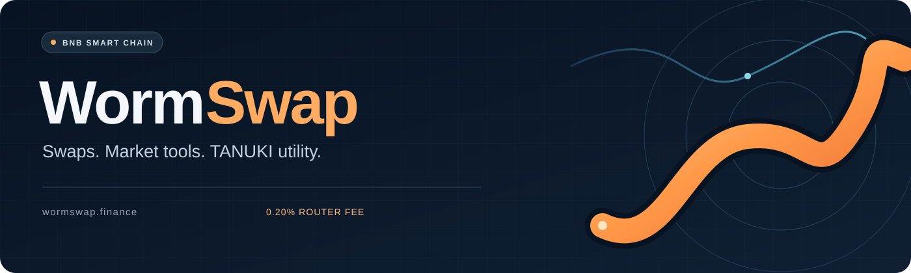
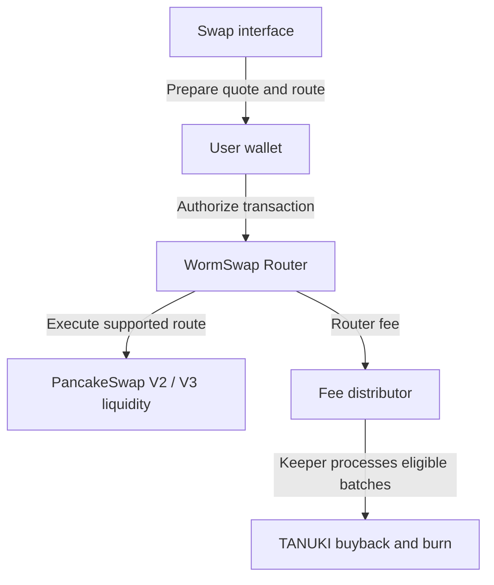

# WormSwap

   
  <strong>Swap BNB Chain tokens. Explore the market. Follow the TANUKI burn cycle.</strong>

  <a href="https://wormswap.finance/swap">Launch Swap</a> ·
  <a href="https://wormswap.finance/tools">Explore Tools</a> ·
  <a href="docs/CONTRACTS.md">Contracts</a> ·
  <a href="https://x.com/WormSwap">X / Twitter</a>

## Built around a connected trading experience

WormSwap brings token swaps, market information and wallet tools together on **BNB Smart Chain**. Its routing system integrates PancakeSwap V2 and V3 liquidity, while a **0.20% WormSwap router fee** supports the TANUKI buyback and burn cycle.

Users connect their own wallets, inspect a quote and authorize transactions through their wallet. Token pages, pool charts and market tools provide context alongside the swap interface.

This repository is the public home for WormSwap's project documentation, architecture and deployment references. The application source and deployment configuration are maintained separately.

## Explore WormSwap

| Product | What it does | Open |
| --- | --- | --- |
| Swap Terminal | Quote and exchange BNB and BEP20 assets through supported routes | [Swap](https://wormswap.finance/swap) |
| Token Explorer | Inspect token reports, liquidity, market information and contract details | [Explorer](https://wormswap.finance/tools) |
| Whale Radar | Follow observed larger trades and token market activity | [Radar](https://wormswap.finance/tools/radar) |
| Holder Rewards | Check reward and dividend information for supported tokens | [Rewards](https://wormswap.finance/tools/rewards) |
| WormShield | Review token allowances and manage supported spending permissions | [Wallet permissions](https://wormswap.finance/tools/shield) |

Swap links preserve the selected assets. For example, [this BNB → TANUKI link](https://wormswap.finance/swap?inputCurrency=BNB&outputCurrency=0x77a9fdeada4d273dc17374106ee5121d9fce7777) opens the relevant pair directly. Imported tokens are stored in the user's browser. See [Features](docs/FEATURES.md) for details and availability limits.

## How the fee supports TANUKI

1. The router charges **20 basis points (0.20%)** on the actual input it receives.
2. Fees accumulate in the WormSwap fee distributor.
3. Authorized keeper processing converts eligible fee batches into TANUKI, subject to the collector's configured limits and price checks.
4. The net TANUKI allocated to the burn is sent to the designated burn address.

The current collector has a fixed **100% burn allocation**. Processing is batched; a swap does not imply an immediate buyback or burn. Token transfer taxes, pool execution costs and network gas are separate from the stated WormSwap router fee.

[Read the fee and burn mechanics →](docs/FEES-AND-BURNS.md)

## On-chain references

**Network: BNB Smart Chain mainnet · Chain ID: 56 · Gas asset: BNB**

| Component | Address |
| --- | --- |
| WormSwap Router | [`0x532Bd585DdB129ea50b0938995d3ac3184c4F1BC`](https://bscscan.com/address/0x532Bd585DdB129ea50b0938995d3ac3184c4F1BC#code) |
| WormFeeDistributor | [`0x66f87B4125b314a8Abd26AbCa7B43da045700Eb5`](https://bscscan.com/address/0x66f87B4125b314a8Abd26AbCa7B43da045700Eb5#code) |
| TANUKI | [`0x77a9fdeaDA4D273Dc17374106Ee5121d9FCe7777`](https://bscscan.com/token/0x77a9fdeaDA4D273Dc17374106Ee5121d9FCe7777) |

The [contract guide](docs/CONTRACTS.md) describes each component. A [machine-readable registry](contracts/bsc-mainnet.json) provides the same addresses for reference.

## Architecture at a glance

The application uses **Next.js, React and TypeScript**, with **wagmi, viem and Reown AppKit** for wallet integration. Solidity contracts execute swaps and collect fees. Market data is read separately from transaction execution.

[Explore the architecture →](docs/ARCHITECTURE.md)

## Development and transparency

The current public product focuses on swaps and market tools. **WormSwap Arena** is a separate game under development and private testing; paid public availability will be announced through official channels.

The [DeFiLlama volume and fee adapter contribution](https://github.com/DefiLlama/dimension-adapters/pull/10265) is under review. Listing status and future product releases are tracked in [Project Status](docs/PROJECT-STATUS.md).

## Documentation and community

- [Features and shareable swap links](docs/FEATURES.md)
- [System architecture](docs/ARCHITECTURE.md)
- [Contracts and deployment registry](docs/CONTRACTS.md)
- [Fee collection and TANUKI burns](docs/FEES-AND-BURNS.md)
- [Product and integration status](docs/PROJECT-STATUS.md)
- [Security reporting](SECURITY.md)
- [Contributing](CONTRIBUTING.md)

**Official channels:** [wormswap.finance](https://wormswap.finance) · [@WormSwap](https://x.com/WormSwap) · [info@wormswap.finance](mailto:info@wormswap.finance)
